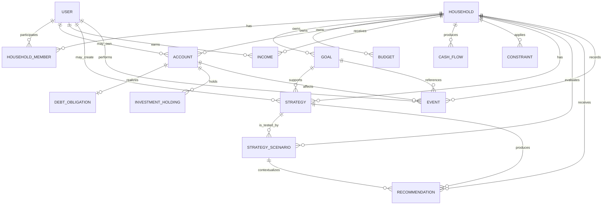

# Household Financial Decision: Data Model Runbook

## Purpose

This runbook defines the canonical data entity model for a household financial decision assistant. It consolidates the domain entities proposed for strategy, goal, constraint, cash-flow and outcome decisions.

It does not include presentation fields, UI configuration or implementation-specific storage details. Social and motivation entities are outside this first core model. The forecast and simulation entities should consume this model rather than duplicate it.

## Modeling principles

- Keep financial state separate from planning objects and decision outputs.
- Persist identities with stable opaque IDs.
- Store timestamps and effective dates for temporal values.
- Use immutable records for events and versioned records for forecasts or recommendations.
- Use a household as the economic unit and a user as the decision participant.
- Model debts and investments as specific account-backed objects, not as strategies.
- Store constraints separately from budgets.
- Store scenarios and recommendations separately from the strategy they evaluate.
- A portfolio is a derived view across `Account`, `DebtObligation` and `InvestmentHolding`; it is not a primary persisted entity.

## Core entity diagram

## 1. User

A person who interacts with the product and can participate in household decisions.

| Element | Type | Required | Definition and constraints |
|---|---|---:|---|
| `user_id` | UUID | Yes | Stable opaque identity for the user. |
| `age` | integer | No | Age at the time of the record or last verified update. |
| `employment_status` | enum | No | Employment state, such as employed, self-employed, retired or unemployed. |
| `income_stability` | enum | No | Stability of expected income, such as stable, variable or uncertain. |
| `location` | location record | No | Jurisdiction or region used for legal, tax and pricing assumptions. Store as structured location data, not free text. |
| `risk_tolerance` | enum | No | Household or individual willingness to accept loss or uncertainty. |
| `behavioral_preferences` | structured set | No | Preferences affecting strategy fit, such as loss aversion or preference for certainty. |
| `time_horizon_preferences` | structured set | No | Preferred planning horizons for short-, medium- and long-term decisions. |
| `financial_knowledge_level` | enum | No | User's declared or assessed financial sophistication. |
| `created_at` | timestamp | Yes | Record creation time. |
| `updated_at` | timestamp | Yes | Last profile update time. |

Relationships:
- A user can belong to one or more households through `HouseholdMember`.
- A user can own or jointly control accounts.
- A user can earn income and create strategies or recommendations through product actions.
- A user can perform events.

This entity does not hold household-level risk limits or shared financial state.

## 2. Household

The economic unit for shared income, expenditure, goals and strategy decisions.

| Element | Type | Required | Definition and constraints |
|---|---|---:|---|
| `household_id` | UUID | Yes | Stable identity for the household. |
| `name` | string | No | User-visible household name. |
| `members` | relationship set | Yes | Users associated with the household through `HouseholdMember`. |
| `shared_accounts` | relationship set | No | Accounts classified as shared or jointly controlled. |
| `shared_budget_owner` | UUID | No | Household or user identity with authority over shared budget operations. |
| `household_risk_profile` | enum or object | No | Aggregated risk posture derived from member preferences and policy. |
| `household_cash_buffer_target` | decimal currency | No | Desired minimum household liquidity. |
| `debt_service_ratio_limit` | decimal | No | Maximum permitted household debt-service ratio. |
| `household_goals` | relationship set | No | Goals owned by the household. |
| `created_at` | timestamp | Yes | Record creation time. |
| `updated_at` | timestamp | Yes | Last household update time. |

Relationships:
- Has one or more `HouseholdMember` memberships.
- Owns goals, budgets, shared accounts, income, constraints and strategies.
- Receives recommendations and produces forecast or cash-flow summaries.
- Records events.

## 3. HouseholdMember

The relationship and permission record between a user and a household.

| Element | Type | Required | Definition and constraints |
|---|---|---:|---|
| `household_member_id` | UUID | Yes | Stable membership identity. |
| `household_id` | UUID | Yes | Household in the membership. |
| `user_id` | UUID | Yes | Participating user. |
| `role` | enum | Yes | Household role, such as owner, contributor or viewer. |
| `decision_authority` | structured set | No | Operations and decisions the user may approve. |
| `joined_at` | timestamp | Yes | Time the membership became active. |
| `status` | enum | Yes | Active, pending or removed. |

Relationships:
- Belongs to exactly one user and one household.
- Controls visibility and authority outside the financial aggregates.

## 4. Goal

A target outcome or condition the household intends to achieve or protect.

| Element | Type | Required | Definition and constraints |
|---|---|---:|---|
| `goal_id` | UUID | Yes | Stable goal identity. |
| `household_id` | UUID | Yes | Household that owns the goal. |
| `name` | string | Yes | User-visible goal name. |
| `goal_type` | enum | Yes | Goal category, such as emergency fund, home purchase, debt reduction or retirement. |
| `target_amount` | decimal currency | Conditional | Target monetary value. Required for amount-based goals. |
| `current_amount` | decimal currency | No | Latest measured or confirmed progress amount. |
| `target_date` | date | No | Target completion date. |
| `priority` | integer | Yes | Relative importance used when goals compete for resources. |
| `urgency` | enum | No | Time sensitivity derived from target date or consequence of failure. |
| `flexibility` | enum | No | Whether the goal amount or date can change. |
| `funding_source` | enum or relationship set | No | Account, income or strategy used to fund the goal. |
| `linked_budget_id` | UUID | No | Budget allocation connected to the goal. |
| `status` | enum | Yes | Proposed, confirmed, active, achieved, paused or cancelled. |
| `created_at` | timestamp | Yes | Goal creation time. |
| `updated_at` | timestamp | Yes | Last goal update time. |

Relationships:
- Owned by a household.
- Can be linked to budgets, accounts, strategies and events.
- A strategy may support one or more goals, but a strategy is not itself a goal.

## 5. Budget

A planned allocation of money over a period. A budget is descriptive planning state, not a hard rule.

| Element | Type | Required | Definition and constraints |
|---|---|---:|---|
| `budget_id` | UUID | Yes | Stable budget identity. |
| `household_id` | UUID | Yes | Household that owns the budget. |
| `period` | enum or date range | Yes | Allocation period, such as weekly or monthly. |
| `category` | enum | Yes | Cost or allocation category. |
| `planned_amount` | decimal currency | Yes | Planned allocation for the period. |
| `actual_amount` | decimal currency | No | Observed amount for the period. |
| `variance` | decimal currency | Derived | `actual_amount - planned_amount`. |
| `owner_user_id` | UUID | No | Member responsible for the allocation. |
| `linked_goal_id` | UUID | No | Goal receiving the allocation. |
| `effective_from` | date | Yes | Start of budget applicability. |
| `effective_to` | date | No | End of budget applicability. |

Relationships:
- Owned by a household.
- May link to one goal and one or more events or cash-flow periods.
- Does not contain hard guardrail logic; that belongs to `Constraint`.

## 6. Account

A financial container holding liquid or invested value, or representing a liability balance.

| Element | Type | Required | Definition and constraints |
|---|---|---:|---|
| `account_id` | UUID | Yes | Stable account identity. |
| `owner_user_id` | UUID | Conditional | Individual owner. Required for individually owned accounts. |
| `household_id` | UUID | Conditional | Household owner or shared decision context. |
| `account_type` | enum | Yes | Checking, savings, credit card, mortgage, brokerage or retirement account. |
| `institution` | string | No | Account provider or institution. |
| `currency` | ISO 4217 code | Yes | Account currency. |
| `current_balance` | decimal currency | Yes | Latest confirmed balance. Negative values may represent liability state where permitted. |
| `available_balance` | decimal currency | No | Balance available to the holder. |
| `liquidity` | enum | No | Immediate, restricted or illiquid. |
| `opening_date` | date | No | Account opening date. |
| `last_synced_at` | timestamp | No | Latest successful data refresh. |
| `status` | enum | Yes | Active, closed or unknown. |

Relationships:
- Owned or controlled by a user and/or household.
- May realize exactly one `DebtObligation`.
- May hold many `InvestmentHolding` records.
- Produces or references events.

An account must not duplicate debt or investment position information. Its balance is the container's financial state.

## 7. Income

A cash inflow source or received income event profile.

| Element | Type | Required | Definition and constraints |
|---|---|---:|---|
| `income_id` | UUID | Yes | Stable income source identity. |
| `household_id` | UUID | Yes | Household receiving the income. |
| `user_id` | UUID | No | Member earning or providing the income. |
| `source` | enum | Yes | Salary, bonus, freelance, rental or other. |
| `amount` | decimal currency | Yes | Expected or last confirmed amount. |
| `recurring` | boolean | Yes | Whether the inflow repeats. |
| `frequency` | enum | Conditional | Required when recurring is true. |
| `variability` | enum | No | Stable, seasonal or unpredictable. |
| `start_date` | date | No | Start of the income source. |
| `end_date` | date | No | Expected or confirmed end date. |

Relationships:
- Belongs to a household and may belong to a user.
- Is a source for cash-flow calculations.
- Changes are represented by events.

## 8. DebtObligation

The legal and financial structure of a liability.

| Element | Type | Required | Definition and constraints |
|---|---|---:|---|
| `debt_id` | UUID | Yes | Stable obligation identity. |
| `account_id` | UUID | Yes | Source account. |
| `debtor_user_id` | UUID | No | User legally responsible for the obligation. |
| `debt_type` | enum | Yes | Revolving, installment, secured or unsecured. |
| `principal` | decimal currency | Yes | Original principal or latest statement principal when an original value is unavailable. |
| `remaining_balance` | decimal currency | Yes | Current liability balance. |
| `apr` | decimal percentage | Yes | Nominal annual interest rate. |
| `minimum_payment` | decimal currency | No | Required recurring payment. |
| `due_date` | date | No | Next or last contractual due date. |
| `term_remaining` | integer months | No | Remaining contractual term. |
| `refinancing_options` | relationship set | No | Known refinancing or restructuring options. |
| `prepayment_penalty` | decimal or boolean | No | Penalty or charge for early repayment. |
| `promotional_apr_end` | date | No | End of a promotional APR period. |
| `status` | enum | Yes | Active, deferred, closed or disputed. |

Relationships:
- Realizes one account.
- Participates in cash-flow debt-service calculations.
- A debt strategy evaluates one or more obligations but does not replace them.

## 9. InvestmentHolding

An actual invested position held in an account.

| Element | Type | Required | Definition and constraints |
|---|---|---:|---|
| `holding_id` | UUID | Yes | Stable holding identity. |
| `account_id` | UUID | Yes | Investment or retirement account holding the position. |
| `asset_class` | enum | Yes | Cash, fixed income, equity, ETF, real estate or alternative. |
| `instrument` | string | No | Fund, ticker or instrument identifier. |
| `quantity` | decimal | No | Units held. |
| `market_value` | decimal currency | Yes | Latest valued market amount. |
| `cost_basis` | decimal currency | No | Basis used for tax and gain calculations. |
| `expected_return` | decimal percentage | No | Scenario or model input, never a guarantee. |
| `volatility` | decimal percentage | No | Expected or historical risk measure. |
| `tax_profile` | structured set | No | Tax treatment, jurisdiction and account-specific tax properties. |
| `time_horizon_months` | integer | No | Expected holding or goal horizon. |
| `valuation_date` | date | Yes | Date of the market valuation. |

Relationships:
- Belongs to exactly one investment account.
- May support goals or strategy scenarios.
- Does not represent a derived household portfolio.

## 10. CashFlow

A time-period snapshot of household inflows, outflows and liquidity.

| Element | Type | Required | Definition and constraints |
|---|---|---:|---|
| `cashflow_id` | UUID | Yes | Stable period snapshot identity. |
| `household_id` | UUID | Yes | Household represented. |
| `period_start` | date | Yes | Start of the period. |
| `period_end` | date | Yes | End of the period. |
| `inflow_total` | decimal currency | Yes | Total recognized inflows. |
| `outflow_total` | decimal currency | Yes | Total recognized outflows. |
| `net_cashflow` | decimal currency | Derived | `inflow_total - outflow_total`. |
| `essential_expense_total` | decimal currency | No | Essential spending in the period. |
| `discretionary_spend` | decimal currency | No | Non-essential spending in the period. |
| `debt_service` | decimal currency | No | Debt principal and interest paid. |
| `savings_contribution` | decimal currency | No | Transfers to savings or investments. |
| `liquidity_buffer` | decimal currency | No | Period-ending uncommitted liquid value. |
| `source` | enum | Yes | Actual, baseline or simulated. |

Relationships:
- Belongs to a household.
- Aggregates accounts, income, budget, debts and events for the period.
- A simulated cash-flow row belongs to a strategy scenario rather than this core period entity.

## 11. Constraint

A hard or soft rule that limits feasible strategies or recommendations.

| Element | Type | Required | Definition and constraints |
|---|---|---:|---|
| `constraint_id` | UUID | Yes | Stable constraint identity. |
| `household_id` | UUID | Yes | Household to which the constraint applies. |
| `constraint_type` | enum | Yes | Liquidity, debt ratio, time, jurisdiction, lifestyle or policy. |
| `value` | decimal, integer or boolean | Yes | Threshold or allowed value. |
| `comparator` | enum | Yes | Greater than, greater than or equal, equal, less than or less than or equal. |
| `rationale` | string | No | Human-readable reason for the rule. |
| `active` | boolean | Yes | Whether the constraint participates in evaluation. |
| `source` | enum | Yes | User, household policy or product guardrail. |
| `effective_from` | date | Yes | Start of applicability. |
| `effective_to` | date | No | End of applicability. |

Relationships:
- Owned by a household.
- Applied by strategy candidate generation and final recommendation guardrails.
- Constraint validity is distinct from a planned budget amount.

## 12. Strategy

A practical action plan for achieving or protecting a goal or improving a financial state.

| Element | Type | Required | Definition and constraints |
|---|---|---:|---|
| `strategy_id` | UUID | Yes | Stable strategy identity. |
| `strategy_type` | enum | Yes | Cost-saving, debt reduction, investment, savings or hybrid. |
| `goal_id` | UUID | No | Primary goal supported. |
| `household_id` | UUID | Yes | Household for which the strategy is evaluated. |
| `created_by_user_id` | UUID | No | User that created or selected the strategy. |
| `name` | string | Yes | Human-readable strategy name. |
| `description` | text | No | Description of the action. |
| `allocation_logic` | structured object | No | Allocation or sequencing rule, such as debt-first or 50/50. |
| `starting_balance` | decimal currency | No | Balance at strategy start. |
| `target_allocation` | structured object | No | Target allocation across debts, savings or investments. |
| `monthly_contribution` | decimal currency | No | Recurring household contribution. |
| `required_upfront_cost` | decimal currency | No | Initial cost required to execute the strategy. |
| `expected_savings_or_return` | decimal currency | No | Point estimate or scenario input, not a guarantee. |
| `risk_level` | enum or object | No | Strategy risk metadata. |
| `assumptions` | structured set | No | User, model or scenario assumptions. |
| `status` | enum | Yes | Candidate, active, rejected, adopted or completed. |
| `created_at` | timestamp | Yes | Creation time. |
| `updated_at` | timestamp | Yes | Last update time. |

Relationships:
- Belongs to a household.
- May support a goal.
- Has many `StrategyScenario` evaluations.
- Can produce recommendations.
- References accounts or obligations through structured allocation logic, not duplicate balance fields.

## 13. StrategyScenario

An evaluation condition for a strategy. It represents assumptions and expected outputs under one possible future.

| Element | Type | Required | Definition and constraints |
|---|---|---:|---|
| `scenario_id` | UUID | Yes | Stable scenario identity. |
| `strategy_id` | UUID | Yes | Strategy being evaluated. |
| `household_id` | UUID | Yes | Household context for the simulation. |
| `scenario_name` | string | Yes | Base, stress, optimistic or another named condition. |
| `inputs` | structured object | Yes | Scenario-specific financial and behavioral inputs. |
| `assumptions` | structured set | Yes | Explicit assumptions and their sources. |
| `expected_outcomes` | structured object | No | Forecasted balances, savings, debt payoff or goal status. |
| `sensitivity_factors` | structured set | No | Inputs whose variation materially changes outcomes. |
| `risk_factors` | structured set | No | Known downside conditions. |
| `decision_score` | structured object | No | Evaluation dimensions and result. |
| `recommended_action` | enum | No | Adopt, conditional, defer or reject. |
| `confidence` | decimal | No | Score in a defined, calibrated range. |
| `computed_at` | timestamp | Yes | Simulation computation time. |

Relationships:
- Belongs to exactly one strategy and one household.
- Supplies evidence and context to a recommendation.
- References goals and constraints through their IDs or computed snapshot.

## 14. Recommendation

The final decision artifact shown to a user or household.

| Element | Type | Required | Definition and constraints |
|---|---|---:|---|
| `recommendation_id` | UUID | Yes | Stable recommendation identity. |
| `household_id` | UUID | Yes | Household receiving the output. |
| `user_id` | UUID | No | Individual recipient when different from household-level approval. |
| `strategy_id` | UUID | Yes | Strategy being recommended or rejected. |
| `scenario_id` | UUID | No | Scenario or forecast context used for the decision. |
| `status` | enum | Yes | Proposed, accepted, conditional, deferred or rejected. |
| `rank` | integer | No | Relative rank among competing strategies. |
| `rationale` | structured set | Yes | Evidence-backed reasons for the decision. |
| `confidence` | decimal | No | Confidence in the recommendation, separate from forecast uncertainty. |
| `alternative_strategy_ids` | UUID array | No | Other strategies considered. |
| `guardrail_results` | structured set | Yes | Hard-constraint checks and any override result. |
| `created_at` | timestamp | Yes | Recommendation creation time. |
| `accepted_at` | timestamp | No | Acceptance or override time. |

Relationships:
- Belongs to a household and optional recipient user.
- References a strategy and optional scenario.
- Is immutable as a versioned recommendation artifact.
- An accepted or rejected result produces an outcome event.

## 15. Event

The append-only timeline of financial and decision activity.

| Element | Type | Required | Definition and constraints |
|---|---|---:|---|
| `event_id` | UUID | Yes | Stable event identity. |
| `household_id` | UUID | Yes | Household in the event context. |
| `user_id` | UUID | No | Member who performed or caused the event. |
| `event_type` | enum | Yes | Transaction, income, budget, goal, strategy, recommendation or override. |
| `timestamp` | timestamp | Yes | Time or effective time of the event. |
| `category` | enum or string | No | Domain-specific category. |
| `amount` | decimal currency | No | Monetary amount when applicable. |
| `linked_account_id` | UUID | No | Account affected. |
| `linked_goal_id` | UUID | No | Goal referenced. |
| `linked_strategy_id` | UUID | No | Strategy referenced. |
| `linked_recommendation_id` | UUID | No | Recommendation referenced. |
| `semantic_label` | string | No | Stable machine-readable interpretation for downstream modeling. |
| `source` | enum | Yes | Open banking, manual, derived or system. |

Relationships:
- Belongs to a household and optional user.
- May link to an account, goal, strategy or recommendation.
- Is the canonical temporal input for behavior and sequence models.
- Events are append-only and should not update mutable account or goal fields directly.

## Relationship and ownership rules

1. `Household` is the default owner of household-wide goals, constraints and strategy decisions.
2. `User` represents an individual member and is not a substitute for a household.
3. `HouseholdMember` defines membership, authority and visibility; it is not itself financial state.
4. `Account` is the container for balances. `DebtObligation` and `InvestmentHolding` describe the position type.
5. `Goal` states desired outcomes. `Strategy` states proposed actions. `StrategyScenario` tests actions under assumptions. `Recommendation` records the decision-facing result.
6. `Budget` is a planned allocation. `Constraint` is a hard or policy limit.
7. `CashFlow` is a period aggregate and is derived from income, expenses, debt service and account changes.
8. `Event` is append-only history. It is not a second copy of current account or goal state.

## Derived entities and views

The following concepts must not be modeled as duplicated persisted entities unless a separate product need is demonstrated:

- **Portfolio**: derived from accounts, debt obligations and investment holdings.
- **Household risk profile**: derived from household state, constraints and member preferences.
- **Net worth**: derived from assets less debts.
- **Available surplus**: derived from cash inflow, essential outflows and hard constraints.
- **Budget variance**: derived from actual and planned budget amounts.
- **Goal progress**: derived from account balances, transfers and scenario outcomes.
- **Recommended allocation**: derived from a strategy and constraint evaluation, and stored only inside a recommendation when versioned output is required.

## Cross-domain extensions

This core model provides the foundation for the following separate entities:

- Social circles, memberships, shared goals and privacy rules for the motivation layer.
- Forecast, scenario timeline, monthly row and uncertainty band entities for the future cash-flow impact capability.
- Strategy alternative comparison and outcome tracking entities for strategy simulation.

Those extensions must reference `Household`, `Goal`, `Strategy` and `Event` instead of recreating household or financial state.

## Open modeling decisions

1. Decide whether `HouseholdMember.decision_authority` is a free permission set or a controlled permission vocabulary.
2. Define the canonical currency and exchange-rate rule for households with accounts in multiple currencies.
3. Define effective-dated history for account balances, goals and constraints.
4. Decide whether scenario assumptions are embedded or referenced as first-class versioned objects.
5. Define confidence and evaluation score ranges consistently across strategy, scenario and recommendation.
6. Decide whether a user can own accounts outside a household and whether those accounts participate in household aggregates with consent.
