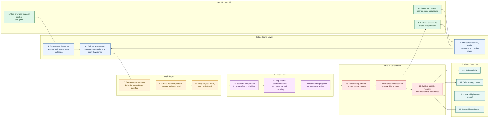
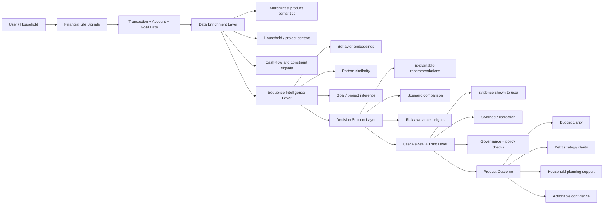
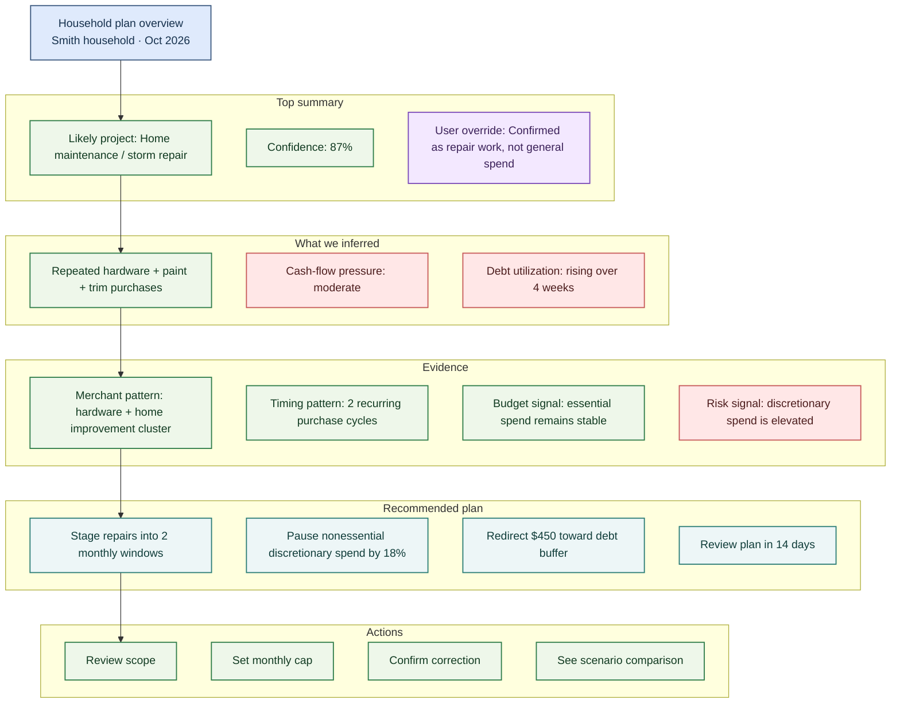

## Transaction foundational models components

The main topical stack is:

- NVIDIA transaction foundation model concepts
  - tokenized event sequences
  - causal sequence modeling / decoder-style pretraining
  - last-token or pooled sequence embeddings
  - downstream task adapters
  - GPU-first workflow and RAPIDS-friendly data prep

- Sequence embeddings as a product primitive
  - person, household, team, project embeddings
  - dynamic embeddings from recent windows
  - inference-time embeddings vs training-time representation learning

- Domain-specific tokenization
  - not just merchant/category strings
  - but user, household, account, merchant semantics, role, goal, constraint, liquidity, project tag, time-of-day, recurring flag, etc.

- Causal language modeling on transaction sequences
  - modeling next event or next state
  - event sequence as “language”
  - domain-aware event vocabularies

- Multi-entity and graph-aware context
  - user → household → team/project → goal/constraint
  - not just a flat “user profile”
  - a relational financial context graph

- Hybrid modeling
  - TFM for event semantics
  - time-series models for periodicity, volatility, forecasting, cash-flow structure
  - fusion into a downstream task layer

- Product memory and personalization
  - confirmed goals
  - user overrides
  - household/project memory
  - calibration from prior confirmed project memory and override history

- Evaluation as product proof, not only model benchmarks
  - groundedness
  - faithfulness
  - user correction handling
  - safety
  - recommendation usefulness
  - conversational quality with DeepEval-style checks

- Domain-specific semantic enrichment
  - merchant catalogs, product descriptions, POS metadata, product taxonomy
  - turning raw merchant names into real semantics like “home improvement materials”, “travel”, “childcare”, “debt pressure”, etc.

### Key concepts

1. Embeddings vs model
- Confusion between:
  - the model itself
  - the embedding vector produced from a sequence
  - the downstream task head
- Need to teach: sequence embeddings are usually generated at inference time from a shared backbone, not a unique model per user.

2. Sequence modeling vs flat feature modeling
- It was not always clear that event sequences carry richer temporal structure than static aggregated features.
- Need to teach: modeling temporal order, event type, repeated patterns, and context is essential.

3. Tokenization semantics are not generic
- User was initially thinking in terms of raw rows and merchant categories.
- Need to teach: tokenization must encode financial semantics, not only text tokens.

4. Product semantics are not the same as model semantics
- The distinction between latent pattern clusters and explicit business objects was still fuzzy.
- Need to teach: latent behavior patterns must be mapped into goal/project/constraint/recommendation objects.

5. Context is not only a single user profile
- User knew multi-entity context mattered, but not fully how it should be represented.
- Need to teach: user, household, team, project, goal, budget, and account are different context layers with different semantics.

6. Training/evaluation is not just benchmark score
- There was a lot of model-first thinking.
- Need to teach: product-critical evals include groundedness, user correction behavior, recommendation usefulness, and safety.

7. Memory is not just chat memory
- There was a common confusion between conversational memory and structured product memory.
- Need to teach: product memory should store confirmed goals, project interpretations, constraints, overrides, and decisions.

8. Time-series + TFM combination is underappreciated
- The user instinctively knew these models are complementary, but it was not fully formalized.
- Need to teach: time-series models capture regularity and volatility, while TFM captures event semantics and latent relational behavior.

9. Local prototyping needs a realistic path
- User wanted practical stack and local setup but not a full research plan.
- Need to teach: use small, strong public datasets and synthetic augmentation; start with a benchmarkable baseline before custom training.

10. Domain-specific evaluation rubrics are necessary
- The user recognized deep evals but needed to map them to real financial criteria.
- Need to teach: use custom financial rubrics rather than generic LLM scoring.

## Roadmap: practical and aligned to the actual product use cases

Roadmap structured as 7 progressive phases, each with value, data, deliverables, and definition of done.

### Week 1 — Learn the core data and product semantics first
Goal:
- Understand what a transaction sequence is and what business semantics matter.

Study topics:
- event schema design
- user/household/team/project/goals
- merchant enrichment
- time ordering and windowing
- semantic labels vs raw labels

Data:
- Public:
  - PaySim
  - BankSim
  - IEEE-CIS Fraud Detection
  - TheLook e-commerce
  - Open Food Facts or catalog metadata
- Optional synthetic:
  - synthetic household structure
  - project labels
  - user objectives
  - household budget states

Deliverables:
- a canonical transaction event schema
- a domain semantic schema
- a 30/60/90-day sequence extraction pipeline
- a documented mapping from raw data to product concepts

Value:
- creates the vocabulary needed for everything else
- stops model work from being generic and disconnected from finance semantics

Definition of done:
- You can explain why a transaction is not just a row but an event with user, household, project, and goal context.
- You can define a valid event schema and sequence window.
- You can show 3–5 example sequences that map to project-like, lifestyle, debt, or household-essential patterns.

Concrete elaboration:

This week is not about modeling yet. It is about turning raw transactions into a decision-oriented object model that the model can understand.

The central question is: what exactly is a financial event in this system?

A raw row like:

```json
{"user_id": "U-1042", "timestamp": "2026-09-15T08:15:00Z", "merchant": "Home Depot", "amount": 184.67, "category": "home_improvement", "account": "credit_card_01"}
```

is not enough to support product-level intent reconstruction. It needs to be lifted into a richer event object, such as:

```json
{
  "event_id": "evt_9f71d4",
  "user_id": "U-1042",
  "household_id": "H-22",
  "project_id": null,
  "account_id": "acct_cc_01",
  "timestamp": "2026-09-15T08:15:00Z",
  "amount": 184.67,
  "currency": "USD",
  "direction": "debit",
  "merchant_name": "Home Depot",
  "merchant_mcc": 5211,
  "merchant_category": "home improvement",
  "merchant_semantic_tags": ["hardware", "tools", "materials", "project_spend"],
  "product_semantics": ["paint", "trim", "wall repair", "DIY project"],
  "recurring_flag": false,
  "time_of_day": "evening",
  "day_of_week": "Saturday",
  "liquidity_state": "tight",
  "balance_after_txn": 2412.40,
  "household_context": ["family_home", "maintenance", "shared_budget"],
  "decision_context": ["home_maintenance", "possible_renovation"],
  "confidence_tags": ["project_like_signal"],
  "project_label": null,
  "goal_label": null,
  "constraint_label": ["budget_pressure", "household_cashflow"],
  "source": "credit_card_transaction"
}
```

This is the layer where product semantics start to emerge. The system is no longer treating the event as a row; it is treating it as a decision signal tied to a goal, a household state, and a likely project thread.

The team should define a small ontology for the first prototype:

- user intent: what the user is likely trying to optimize or do
- household context: how shared obligations and family decisions affect spend
- project context: whether the event belongs to a temporary or recurring goal
- constraint context: liquidity pressure, debt burden, monthly budget limits
- decision object: a structured summary of likely goal / tradeoff / evidence

Concrete data work for this week:

- decide on a 30-day, 60-day, and 90-day sequence window
- define which fields remain raw vs. enriched vs. derived
- create rules for semantic enrichment, such as:
  - hardware store + paint + drywall = likely home-maintenance or renovation
  - gas station + tolls + parking + transit = likely commute or mobility cost
  - grocery + childcare + pharmacy = household essentials / family stability
- attach household or project metadata where available, even if only synthetic for the prototype

Interesting demo for this week:

Demo name: “Project-like spending in a household budget”

Use a synthetic or semi-synthetic household dataset with these events over 8 weeks:

- 3x grocery trips
- 2x hardware store purchases
- 2x paint and tool purchases
- 1x delivery fee for building materials
- 1x family dining expense

The first pass is to label this sequence in plain language:

- likely objective: home improvement / property upkeep
- household burden: shared family home repair budget
- possible constraint: limited cash flow and a current credit-card balance warning
- likely interpretation: this is not general “spending drift”; it is a structured project pattern

The demo should end with a decision brief, for example:

- likely goal: home maintenance / renovation
- evidence: recurring material purchases converge on same household and time window
- constraint: budget tightness due to recent credit usage
- recommendation: phase the project into two monthly sprints and reduce discretionary spending for 6 weeks

This converts raw transaction data into a product story: the model is not just counting spend, it is reconstructing a likely financial decision thread.

Definition of value:
- creates a durable object model for later sequence modeling
- makes downstream modeling interpretable and grounded in actual product behavior
- provides a reusable data contract for all remaining weeks

Definition of done:
- the event schema is agreed and versioned
- sample data for at least 3 realistic spending patterns exists
- at least one example sequence can be mapped into a decision brief with inferred project and constraint

### Week 2 — Build a tokenization and serialization pipeline

Concrete elaboration:

This week is about converting event objects into a sequence representation that a model can consume. The goal is not to build a production tokenizer yet; it is to define a practical, explainable sequence language for financial events.

The key idea is simple: do not feed raw merchant names and amounts directly as if they were arbitrary numbers. Instead, create tokens that preserve meaning and structure.

Example raw event sequence:

```text
2026-09-04 Home Depot paint + supplies $89.40
2026-09-06 Lowe's plumbing + tools $146.10
2026-09-09 grocery + household supplies $72.20
2026-09-12 fuel + parking $38.00
2026-09-15 Home Depot trim + screws $64.80
2026-09-17 grocery + household supplies $81.50
```

A first-pass tokenized representation could look like this:

```text
[USER:U-1042, HOUSEHOLD:H-22, DAY:SAT, EVENT:MERCHANT_HOMEDEPOT, TAG:DIY, TAG:MATERIALS, AMOUNT:89.40, CATEGORY:HOME_IMPROVEMENT, CONTEXT:PROJECT_LIKE, ACCOUNT:CREDIT_CARD]
[USER:U-1042, HOUSEHOLD:H-22, DAY:MON, EVENT:MERCHANT_LOWES, TAG:PLUMBING, TAG:TOOLS, AMOUNT:146.10, CATEGORY:HOME_IMPROVEMENT, CONTEXT:PROJECT_LIKE, ACCOUNT:CREDIT_CARD]
[USER:U-1042, HOUSEHOLD:H-22, DAY:WED, EVENT:MERCHANT_GROCERY, TAG:ESSENTIALS, AMOUNT:72.20, CATEGORY:HOUSEHOLD_ESSENTIALS, CONTEXT:STABLE_BASELINE, ACCOUNT:DEBIT_CARD]
[USER:U-1042, HOUSEHOLD:H-22, DAY:SAT, EVENT:MERCHANT_FUEL, TAG:COMMUTE, AMOUNT:38.00, CATEGORY:TRANSPORT, CONTEXT:ROUTINE, ACCOUNT:DEBIT_CARD]
[USER:U-1042, HOUSEHOLD:H-22, DAY:MON, EVENT:MERCHANT_HOMEDEPOT, TAG:TRIM, TAG:REMODEL, AMOUNT:64.80, CATEGORY:HOME_IMPROVEMENT, CONTEXT:PROJECT_LIKE, ACCOUNT:CREDIT_CARD]
[USER:U-1042, HOUSEHOLD:H-22, DAY:WED, EVENT:MERCHANT_GROCERY, TAG:ESSENTIALS, AMOUNT:81.50, CATEGORY:HOUSEHOLD_ESSENTIALS, CONTEXT:STABLE_BASELINE, ACCOUNT:DEBIT_CARD]
```

This is much richer than raw text alone. The model is now seeing:

- merchant semantics
- project-like behavior
- category type
- household context
- liquidity or account state
- temporal ordering

A more structured event schema for this week could be:

```json
{
  "user_id": "U-1042",
  "household_id": "H-22",
  "timestamp": "2026-09-04T10:30:00Z",
  "merchant": "Home Depot",
  "merchant_semantic_tags": ["hardware", "materials", "DIY", "project_spend"],
  "amount": 89.4,
  "currency": "USD",
  "category": "home_improvement",
  "account_type": "credit_card",
  "liquidity_state": "tight",
  "time_bucket": "weekend",
  "event_role": "project_material_purchase",
  "sequence_context": "household_maintenance_window"
}
```

Core rules for the tokenizer:

- preserve business meaning, not just the raw string
- keep numeric values but derive semantic buckets where useful
- encode temporal context separately: day, week, recurring cadence
- add user / household / project context as event metadata
- distinguish between routine spend and project-like spend
- include explicit decision features such as whether the merchant purchase seems planned or discretionary

Concrete deliverables for this week:

- a serialization script that converts raw transactions into token sequences
- a notebook showing 3 tokenized sequences for different user types
- a custom vocabulary file with categories like:
  - `HOME_IMPROVEMENT`
  - `COMMUTE`
  - `HOUSEHOLD_ESSENTIALS`
  - `TRAVEL`
  - `DEBT_PRESSURE`
  - `DISCRETIONARY_LIFESTYLE`
- a simple rule-based enrichment layer for “project-like” vs. “routine-like” patterns

Interesting demo for this week:

Demo name: “From transaction stream to sequence language”

The demo begins with a short list of raw card transactions and ends with a sequence representation that highlights a likely project thread.

Example narrative:

Raw transactions:

- 2026-09-04: Home Depot paint + hardware — $89.40
- 2026-09-06: Lowe's plumbing tools — $146.10
- 2026-09-09: grocery staples — $72.20
- 2026-09-12: fuel + parking — $38.00
- 2026-09-15: Home Depot trim + screws — $64.80
- 2026-09-17: grocery staples — $81.50

After tokenization, the sequence reads like:

```text
[PROJECT_LIKE, MATERIALS, HOME_IMPROVEMENT]
[PROJECT_LIKE, TOOLS, HOME_IMPROVEMENT]
[ESSENTIALS, HOUSEHOLD]
[COMMUTE, TRANSPORT]
[PROJECT_LIKE, MATERIALS, HOME_IMPROVEMENT]
[ESSENTIALS, HOUSEHOLD]
```

Now the system can infer:

- this user has a recurring household project thread
- there is a stable baseline of essentials and mobility costs
- the project spend has a different pattern from routine spend
- the event stream is a mixture of baseline and project-like behavior

This creates the exact kind of representation needed for later embedding and modeling work.

Definition of value:
- this is the direct bridge from raw transaction records to a learned sequence representation
- it demonstrates that a transaction stream can behave like a financial language, not a flat table
- it gives a simple product story that non-technical stakeholders can understand

Definition of done:
- you can convert a list of transactions into a tokenized sequence
- the sequence clearly separates project-like spending from essentials and commute costs
- you can explain why the token sequence is more meaningful than raw merchant names alone

### Week 3 — Baseline embedding experiments with public OSS models

Concrete elaboration:

This week is the first real modeling pass. The goal is not to train a custom model yet; it is to prove that embeddings from a standard sequence or text embedding model can separate meaningful financial behavior patterns.

This matters because if a generic embedding model cannot retrieve similar project-like sequences or distinguish core household patterns, then a custom domain model will not be an easy win.

Recommended model candidates:

- BGE-M3
- E5-large-v2
- Jina embeddings
- Nomic Embed
- a compact sentence-transformer model if the sequence is serialized into text-like tokens

For an initial prototype, the simplest setup is:

1. serialize each user or household sequence into a text block or token listing
2. embed the sequence with one of the above models
3. compute pairwise similarity or nearest-neighbor retrieval
4. inspect whether similar sequences cluster around meaningful user patterns

Example input sequence for a user window:

```text
User: U-1042 | Household: H-22
[PROJECT_LIKE, MATERIALS, HOME_IMPROVEMENT]
[PROJECT_LIKE, TOOLS, HOME_IMPROVEMENT]
[ESSENTIALS, HOUSEHOLD]
[COMMUTE, TRANSPORT]
[PROJECT_LIKE, MATERIALS, HOME_IMPROVEMENT]
[ESSENTIALS, HOUSEHOLD]
```

This sequence can be converted to a text representation such as:

```text
User U-1042 household H-22 sequence: project_like materials home_improvement; project_like tools home_improvement; essentials household; commute transport; project_like materials home_improvement; essentials household
```

Then embed this text and compare it to other windows.

Concrete workflow:

- build a collection of sequenced windows for 100–1000 users or households
- use a generic embedding model to vectorize each sequence
- compute similarity between each sequence and all others
- inspect nearest neighbors to see whether the model surfaces similar patterns
- evaluate whether “similar” means the same underlying behavior, not just same vendor or same amount

Example output for a retrieval task:

```text
Query sequence: household home improvement project, materials + tools + occasional essentials
Nearest neighbors:
1. household home repair sequence, similar material purchases, project-like spending
2. seasonal home maintenance sequence, same material tags and timing pattern
3. household budget stress pattern with project-like spend and recurring essentials
4. unrelated discretionary lifestyle pattern — lower similarity
```

This is a critical moment in the roadmap: it tells you whether the representation is carrying signal that is relevant to product intent, not just generic lexical overlap.

Concrete deliverables for this week:

- embedding pipeline script for sequence windows
- notebook showing sequence retrieval results
- similarity matrix or nearest-neighbor report
- simple evaluation file that records whether retrieved sequences match the intended category

Evaluation questions to ask:

- Do similar sequences cluster around project-like spending?
- Do commute sequences stay separate from home-project sequences?
- Do household essentials and discretionary lifestyle spending remain distinct?
- Are the nearest neighbors semantically meaningful to a human reviewer?

Interesting demo for this week:

Demo name: “Find the most similar household project behavior”

We need a small dataset of several households with different spending modes:

- Household A: home improvement project over 6 weeks
- Household B: travel planning with seasonal discretionary purchases
- Household C: childcare and household essentials, stable recurring spend
- Household D: personal lifestyle discretionary spending, no clear project thread
- Household E: debt pressure and cash-flow stress with a few one-off big purchases

The demo query is:

"Find households with spending behavior most similar to a home-maintenance project pattern."

The system returns a ranking like:

```text
Top matches:
1. Household A — 0.89 similarity — repeated materials + tools + weekend purchases + occasional essentials
2. Household F — 0.81 similarity — similar home maintenance + hardware cluster, slightly more budget pressure
3. Household C — 0.62 similarity — essentials and household costs, but not project-like enough
4. Household B — 0.41 similarity — travel pattern; partially similar in seasonality but different semantic tags
```

This is compelling because it demonstrates that vector similarity can surface real behavioral families without requiring explicit labels.

The demo can be presented as a product feature: “We found the spending pattern most similar to your current household project behavior.”

This is valuable because it becomes a clear bridge to:

- project inference
- recommendation matching
- evidence retrieval
- explanation generation
- user review and correction

Definition of value:
- proves the representation layer works before custom training
- creates a baseline for later improvements
- gives a simple human-readable demo that product teams can understand

Definition of done:
- the embedding workflow runs on a small dataset
- nearest-neighbor retrieval answers a real behavioral question
- the results are interpretable by a person without technical background
- you can explain why one household is more similar to another than a third

Next concrete pass: Week 4, where we train a compact custom sequence encoder and show how the same home-improvement scenario improves beyond the baseline.
Phase 4: Build a small custom sequence encoder
Goal:
- Train a compact domain sequence model.

Study topics:
- transformer encoder / decoder
- sequence pooling
- causal event modeling
- event order and temporal positions
- input masking and sequence windows

Data:
- user/household/project windows with labels
- weak labels for project intent, recurring pattern, budget pressure, discretionary vs essential spend

Deliverables:
- small transformer-based sequence encoder
- training pipeline for sequence windows
- output embedding vector per entity
- reduced benchmark report vs baseline

Value:
- this is the real “NVIDIA-like” learning step
- moves from generic embeddings to finance-specific representation learning

Definition of done:
- A model can accept a 30/60/90-day transaction sequence and produce a sequence embedding.
- You can show that the model separates:
  - home-project patterns
  - travel patterns
  - recurring essentials
  - debt/liquidity stress
- You can compare embeddings against the generic baseline and explain the gain.

### Week 4 — Train a compact custom sequence encoder

Concrete elaboration:

This week is the first major modeling step. The goal is to replace a generic embedding baseline with a compact, domain-aware sequence encoder trained on financial event sequences.

This is where the project begins to look like a real transaction foundation model prototype rather than a generic text-embedding pipeline.

The design goal is intentionally modest:

- sequence length: 30 to 90 days
- small architecture: a compact transformer or temporal encoder
- output: one vector embedding for each user, household, or project window
- task: learn whether a sequence is project-like, routine, essential, travel, or debt-pressure oriented

A minimal training setup could look like this:

- input: tokenized transaction windows
- model: small transformer encoder over event embeddings
- pooling: mean or last-token pooling
- output: sequence embedding
- downstream head: classification or contrastive learning

Example training sample:

```text
Window: User U-1042, household H-22, 42-day sequence
project_like materials home_improvement
project_like tools home_improvement
essentials household
commute transport
project_like materials home_improvement
essentials household
project_like trim home_improvement
```

The model learns that:

- repeated project-related events cluster together
- household essentials create a stable baseline
- commute and discretionary lifestyle patterns are separate semantic trajectories
- project-like sequences often reappear in windows with a similar structure

Concrete deliverables for this week:

- a compact sequence transformer or temporal encoder script
- a training notebook that runs on a small dataset
- a saved embedding output for a set of sequences
- a comparison report against the Week 3 baseline embeddings

Evaluation plan for the custom encoder:

- compare nearest-neighbor retrieval quality
- compare clustering around project-like sequences
- compare classification accuracy on a selected set of labels
- inspect whether the model separates project-like signals from routine essentials

We want to answer a simple but valuable question:

“Does the custom model find the same financial project pattern more reliably than generic identity-based embeddings?”

Interesting demo for this week:

Demo name: “The home-improvement project is easier to detect after custom sequence learning”

We use the same household dataset from earlier, but now the sequence encoder is trained on a small set of labeled windows:

- home_improvement_project
- travel_planning
- household_essentials
- discretionary_lifestyle
- debt_pressure

Then we query the model with a new household sequence:

```text
User U-2048, 45-day sequence
hardware_store + paint + garage_supply + home_center + delivery_fee + grocery + fuel + parking
```

The baseline model may return a mix of generic “similar” sequences and noisy matches.

The custom model should produce something sharper, such as:

```text
Predicted sequence class: home_improvement_project
Confidence: 0.82
Evidence:
- repeated materials and hardware purchases
- project-like cluster across consecutive weeks
- household essentials remain stable baseline, not dominant signal
- commute costs are minor and not the primary driver
```

This is the first time the project starts to feel tangible as a product feature: the system is not just finding similar sequences; it is inferring a real intent pattern.

Definition of value:
- establishes a custom financial sequence representation as a real asset
- gives a direct bridge from generic embeddings to product-specific intent reconstruction
- creates a model output that can later be used in recommendations and explanations

Definition of done:
- a small encoder trains successfully on a local dataset
- the custom sequence embedding improves over the generic baseline on a focused behavior task
- the model can classify or surface likely project-like sequences with a sensible explanation

Next concrete pass: Week 5, where we add household, project, and goal context to show why a flat user profile is insufficient.
Phase 5: Add household, team, project, and goal context
Goal:
- Teach multi-entity understanding.

Study topics:
- graph-aware context
- multi-entity embeddings
- user/household/team constraints
- project context as first-class feature
- shared household budgeting

Data:
- synthetic household metadata
- household project labels
- team or family account mappings
- goal tags and constraints

Deliverables:
- user, household, and project embedding outputs
- a context fusion design
- context-aware intent classification or project head

Value:
- reveals why a flat user profile is insufficient
- directly maps to SwiftSparrow’s “household/team context and implicit decision reconstruction” product idea

Definition of done:
- You can show a household where two members each have their own sequences but a shared spending goal or project.
- You can produce separate embeddings for:
  - user
  - household
  - active project
  - shared budget
- Your intent inference improves when context is added.

### Week 5 — Add household, project, and goal context

Concrete elaboration:

This week is the most important conceptual shift in the roadmap. The goal is to show that a single user profile is not enough. In finance, decision behavior is usually determined by a nested context stack:

- user
- household
- shared budget
- team or project
- active goal or constraint

This is where the “graph-aware context” idea becomes concrete.

The core question for the week is:

When does a behavior need to be interpreted as an individual signal, and when does it need to be interpreted as a household or project signal?

Example scenario:

User A and User B are married and share a household budget.

Their events are:

- User A: grocery + home improvement + fuel
- User B: childcare + streaming + family dining + online booking

On their own, the events look like ordinary spend. But in the household context, a sequence emerges:

- material purchases cluster around a home-renovation or maintenance effort
- childcare and family dining are stable household costs
- a trip booking may be connected to a family travel goal or seasonal plan
- both users share a constrained monthly budget and a total spend target

Without household context, the model sees disconnected transactions. With household context, it sees a shared decision pattern.

A realistic context schema for this week:

```json
{
  "user_id": "U-1042",
  "household_id": "H-22",
  "project_id": "P-91",
  "goal_context": "home_maintenance_and_stability",
  "budget_owner": "shared_household_budget",
  "constraint_context": ["monthly_budget_cap", "credit_card_pressure"],
  "household_roles": ["parent", "primary_buyer"],
  "transaction_time_window": "2026-09-01 to 2026-10-15"
}
```

The model should then produce at least three views:

1. user embedding
2. household embedding
3. project embedding

This lets the system reason at different levels:

- the user is buying tools for a hobby project
- the household is preparing for a longer-term maintenance cycle
- the project is likely tied to a specific budget objective or milestone

Concrete deliverables for this week:

- context-aware sequence encoder or fusion model
- household/project metadata definitions
- comparison between flat profile performance and context-aware performance
- a notebook that shows the same sequence before and after context is added

Evaluation question:

Does performance improve when the model includes household and project signals compared to a flat user-only model?

Interesting demo for this week:

Demo name: “The same purchase means different things without household context”

Example case:

- User A buys a paint kit for $120
- User B buys a family travel booking for $600
- Household metadata shows both events are part of a shared household plan with a total budget cap

Without context:

- paint is just a home improvement purchase
- travel booking is just discretionary spend

With household context:

- the system sees competing priorities: home upkeep vs. family travel vs. budget pressure
- it can infer a tradeoff narrative
- it can tell the user that their household is balancing a maintenance project with a planned family trip under a tight cash-flow window

This is the key product insight: the system should not treat “purchase” as a standalone event; it should treat it as part of a higher-order decision structure.

This is also where the model can produce a more useful decision brief, such as:

```text
Likely household goal: maintain home while protecting budget stability
Likely project: home repair or maintenance window
Observed tradeoff: planned discretionary family travel is competing with home maintenance spend
Recommendation: stage renovation in two phases; defer nonessential travel spend by 1 month
```

This is much stronger than a generic “you are spending money” summary.

Definition of value:
- adds the necessary relational structure to the model
- makes the system more product-aware and decision-aware
- creates a clear case for graph-aware or multi-entity modeling

Definition of done:
- the same sequence is evaluated with and without household/project context
- the context-aware version yields more sensible project or goal inference
- the product can explain a tradeoff between household goals and constraints

Next concrete pass: Week 6, where we integrate time-series and forecasting signals and show how a hybrid TFM + time-series model better captures cash-flow stress and seasonality.
### Week 6 — Add hybrid time-series and forecasting features

Concrete elaboration:

This week addresses a real gap in pure sequence-model thinking: not all patterns are semantic; some are temporal, cyclical, and financial.

A user may have a project-like sequence, but the true risk signal may come from a cash-flow pattern: income timing, spending volatility, debt load, or recurring obligations. A purely semantic sequence model can describe the pattern but cannot always explain why it matters financially.

This is why the architecture should include a hybrid layer:

- TFM or sequence encoder captures event semantics and latent behavior patterns
- time-series model captures cadence, seasonality, volatility, and cash-flow dynamics

Example financial features for a weekly or daily series:

- spending total by day
- income vs. outflow
- recurring transfer patterns
- credit utilization trend
- merchant category signals over time
- volatility of spending intensity
- recurring fixed costs vs. project-like spikes

Concrete workflow:

1. create a daily spend series for each account or household
2. compute variance, seasonality, and volatility features
3. join them with the sequence embedding output from the custom encoder
4. train a small downstream model to predict:
   - likely budget stress
   - likely spending regime shift
   - upcoming project pacing risk
   - mismatched cash-flow vs. project spend

Example hybrid feature vector:

```text
sequence_embedding = [0.13, -0.56, ...] 
periodicity_features = [weekly_spend_volatility, recurring_credit_peak, income_gap]
context_features = [household_budget_cap, household_goal, project_phase]
```

This is what gives the model financial intuition instead of only event-sequence intuition.

Concrete deliverables for this week:

- time-series feature engineering notebook
- a simple forecasting or stress model
- hybrid feature table combining sequence embeddings and time-series statistics
- a report comparing pure sequence modeling vs. hybrid modeling

Interesting demo for this week:

Demo name: “Cash-flow pressure explains the project”

Dataset pattern:

- household continues buying home materials across 6 weeks
- a recurring fixed income pattern remains stable
- credit-card utilization rises sharply
- weekend material purchases cluster around the same period each month

Without time-series context, the system may only say:

“Project-like spending is increasing.”

With hybrid features, the system can say:

```text
Observed pattern:
- project-like material purchases are recurring in a consistent cadence
- the household’s cash-flow slack is shrinking week over week
- the same household has a debt-service burden and a narrow budget cap
- the project is likely not just a hobby; it is a constrained home-maintenance effort
Interpretation:
- this should be treated as a budget-staged project, not a generic discretionary drift
Recommendation:
- phase the work over 2 months
- pause discretionary purchases
- prioritize essential materials and defer noncritical upgrades
```

This is a strong product narrative because it combines semantic pattern recognition with actual financial pressure signals.

Definition of value:
- connects the latent sequence model to concrete financial risk and planning signals
- proves that time-series structure matters for user context and planning
- gives more explainable planning insight than raw sequence similarity alone

Definition of done:
- a hybrid model produces a stress or pacing explanation with evidence
- the model can distinguish seasonal project behavior from pure overspend
- the output can be turned into an actionable recommendation

Next concrete pass: Week 7, where we add memory, calibration, and a user override loop that shows how the model learns from corrections.
### Week 7 — Add memory, calibration, and user correction loops

Concrete elaboration:

This week transforms the prototype from a static model into a personalized product system. The key question is:

How does the system remember what it has learned, and how does it update when the user corrects it?

This is where product memory becomes essential. The model should not just remember chat logs; it should retain structured facts such as:

- confirmed project goals
- user overrides and corrections
- household priorities
- past decisions and their outcomes
- constraint changes over time

A minimal memory schema could look like:

```json
{
  "user_id": "U-1042",
  "household_id": "H-22",
  "memory_type": "project_goal",
  "subject": "home_maintenance_project",
  "status": "confirmed",
  "confidence": 0.88,
  "evidence": ["hardware_store", "paint", "trim", "trade_tools"],
  "created_at": "2026-09-20T12:00:00Z",
  "updated_at": "2026-10-02T10:00:00Z",
  "notes": "User confirmed this is home maintenance, not discretionary lifestyle spend"
}
```

This is not conversational memory; it is product memory that affects future recommendations and intent inference.

The model should also have a calibration layer. A base model may produce a probability like:

- “project likelihood = 0.74”

But after context, user override, or memory retrieval, the product should reweight it based on trusted facts.

For example:

- base signal: 0.74 home-project likelihood
- memory: user previously confirmed a home-maintenance project
- user override: “This is not discretionary; it is a household repair project”
- calibration adjustment: probability shifts upward to 0.89

Concrete deliverables for this week:

- memory schema and retrieval logic
- simple calibration layer prototype
a small override flow where the user can correct a predicted goal
- a decision object that stores evidence, assumptions, and confidence

Interesting demo for this week:

Demo name: “The user corrects the model and the system learns”

Initial model output:

```text
Predicted goal: discretionary household spending
Confidence: 0.58
```

User correction:

```text
User says: “This is actually a home repair and maintenance project, not just general discretionary drift.”
```

After memory and calibration:

```text
Updated goal: home_maintenance_project
Confidence: 0.87
Memory updated: confirmed project narrative for household H-22
Recommendation recalibrated: phase the renovation into two monthly buckets and reduce nonessential spending
```

This demonstrates a crucial product principle: the model is not simply generating a static outcome, it is learning from user feedback in a structured way.

This is the difference between a demo and a real product loop.

Definition of value:
- enables personalization without building a separate model per user
- creates durable product memory that influences future decisions
- turns model uncertainty into a reviewable, correctable product workflow

Definition of done:
- a user can correct a model output and the system stores the update
- memory affects future inference for the same household or user
- the recommendation confidence is updated in a way the user can inspect

Next concrete pass: Week 8, where we do product evaluation and show how to evaluate the end-to-end system with DeepEval-style conversational and groundedness checks.
### Week 8 — Product evaluation and end-to-end proof

Concrete elaboration:

This final week is about proving the system is useful as a product, not just technically interesting as a model. The best evaluation for this project is not only benchmark accuracy; it is product proof.

The evaluation must answer questions such as:

- Did the system correctly infer a likely project or goal?
- Did it produce evidence and explain its reasoning?
- Did it respond appropriately when the user corrected it?
- Did it recommendation align with the user’s constraints and household context?
- Did it avoid over-claiming or making unjustified financial assertions?

A simple evaluation rubric could include:

- project inference quality
- explanation quality
- user correction handling
- groundedness to actual transaction evidence
- recommendation usefulness
- safety and overconfidence control
- conversational quality in multi-turn interactions

Example evaluation prompt for a conversational run:

```text
User: My spending has been weird lately. I think I’m just buying random things.
Assistant: Based on the last 6 weeks, your pattern looks more like a home-maintenance project than random drift. You have repeated hardware purchases, paint-related materials, and a stable baseline in essentials. The main risk is that cash flow is tight, so the project should be staged over two months.
User: No, this is really for repair work after the storm, not just a general home project.
Assistant: Understood. I’ve updated the project interpretation to storm-related home repair, and the recommendation now prioritizes urgent repairs and defers nonessential discretionary spend.
```

The evaluation should score the second response on:

- grounding: does the assistant reference the real evidence in the transaction stream?
- correction handling: does it update appropriately after user feedback?
- safety: does it avoid overconfident claims?
- usefulness: does it give a practical recommendation?

Concrete deliverables for this week:

- evaluation rubric and scoring sheet
- conversation benchmark set
- recommendation quality report
- product-proof demo with explanation and correction loop

Interesting demo for this week:

Demo name: “Decision brief with evidence and revision”

The final presentation should not just say “the model predicted a home project.”

It should show a full product workflow:

```text
1. Sequence analysis finds repeated materials + tools + weekend purchases.
2. The system infers a likely home-maintenance project.
3. The system explains the inference with evidence.
4. The user says the project is actually storm damage repair.
5. The system updates the project label and prioritizes urgent repairs over discretionary spending.
6. The assistant offers a staged recommendation and confidence score.
```

This is the strongest demonstration because it shows that the system is not only identifying a signal but also operating as a decision-support system with review and correction.

The final product-ready output might look like this:

```text
Decision brief
- likely goal: storm repair / household maintenance
- likely constraint: cash-flow pressure and credit utilization spike
- evidence: repeated hardware purchases, increased materials spend, repair-like merchant tags
- recommended strategy: stage repair work into two monthly windows and cut discretionary spend
- confidence: medium-high
- assumptions: user has not yet explicitly confirmed the full repair scope
- user override state: corrected from generic home project to storm repair
```

This is exactly the type of output that makes the system feel like a real product rather than a toy model.

Definition of value:
- proves the model can support user trust and review
- makes the project testable in a realistic product workflow
- closes the loop from raw data to decision support to human correction

Definition of done:
- at least one end-to-end conversational run is evaluated against a rubric
- the system shows evidence and explains uncertainty well
- the user can correct the interpretation and the system updates meaningfully
- the output is product-presentable, not just internally interesting

## Final prototype milestone

The project is considered successful when it produces a working prototype that can:

- ingest transaction sequences
- serialize them into a meaningful financial token language
- generate embeddings for behavior patterns
- infer a likely goal, project, or constraint
- incorporate household and project context
- combine event semantics with time-series structure
- store memory and calibrate after user correction
- explain its thinking with evidence and confidence
- survive a product-grade evaluation loop

That is the real end-state value of the roadmap, and it is the strongest translation from the NVIDIA-style transaction foundation model concepts into a credible finance product.

### High level business process flow




### High level data flow


### Example user screen: household project and debt planning view



-----
## NVIDIA blueprint alignment: what the repo actually does and what it does not

The blueprint is a strong reference implementation for a transaction foundation model, but it is not a full product-memory or customer-context architecture. It is a base sequence representation layer for transaction events.

What the repo confirms:

- The core pipeline is:
  1. transaction data ingestion
  2. temporal splitting by user/card
  3. domain-specific tokenization
  4. sequence building like `<bos> ... <sep> ... <eos>`
  5. decoder-only causal language modeling
  6. last-token or pooled embedding extraction
  7. downstream task adaptation (e.g., XGBoost fraud detection)

- The tokenizer is intentionally domain-specific, not generic BPE.
  - amount is binned into meaningful ranges such as `AMT_0`, `AMT_1`, ...
  - merchants are hashed into a fixed vocabulary (`MERCH_...`)
  - category is mapped via MCC / industry hierarchy (`CAT_...`)
  - time is decomposed into temporal tokens such as `HOUR_XX`, `DOW_X`, `MONTH_XX`
  - optional time-delta and temporal features are included

- Sequence construction is specific and practical:
  - a transaction sequence is created by grouping by user/card
  - chunks are limited by context length
  - the repo explicitly notes that roughly 315 transactions fit into a 4096-token context window when using a compact, domain-specific tokenizer
  - the design goal is to fit more meaningful transaction history into a single model context than a general-purpose tokenizer would allow

- The model itself is a decoder-only transformer, roughly 29M parameters, 8 layers, hidden size 512, with grouped-query attention and a context window of 8192.

- Training is causal LM / next-token prediction, not user-profile modeling or explicit financial-intent reconstruction.
  - the model learns from transaction sequences alone
  - labels are not required for pretraining
  - downstream tasks are added later using extracted embeddings

- Embeddings are extracted via last-token pooling and then used in a downstream classifier (XGBoost in the repo example).
  - this is a critical architectural point for our roadmap
  - a foundation model produces sequence embeddings or contextualized states
  - downstream task adapters can then learn product-specific behavior

- The repo does not implement a household or team-level relational graph as a first-class product object.
  - there is no explicit multi-entity memory layer in the blueprint
  - there is no user override / project memory / household budget graph in the base repo

What this means for the roadmap:

1. The NVIDIA repo is the correct starting point for the representation layer.
   - replicate the tokenizer
   - replicate the causal LM training flow
   - extract embeddings from the last token
   - test a downstream task

2. The roadmap should add a second layer for real product context.
   - user + household + team/project context
   - goal / constraint / debt / cash-flow signals
   - product memory and override history
   - decision objects instead of only latent vectors

3. The “customer profile” is not central in the blueprint itself.
   - it is mostly there as grouping metadata and transaction context
   - the blueprint is not a CRM or flat-profile model
   - it is a transaction-sequence model

4. The correct interpretation for our use case is:
   - base blueprint = transaction sequence foundation model
   - our product system = foundation model + context fusion + memory + calibration + recommendation layer

5. The repo strongly supports our earlier emphasis on tokenization and domain-specific event serialization.
   - this is not optional
   - in fact, the repo’s design makes the point that domain tokenization is the main lever for productive modeling

This means we should add one explicit milestone to the roadmap before the custom modeling steps:

### NVIDIA baseline reproduction milestone

Objective:
- replicate the core NVIDIA blueprint with a small local dataset and a simplified tokenizer

Deliverables:
- working domain-specific tokenization pipeline
- causal LM training on grouped transaction sequences
- embedding extraction with last-token pooling
- downstream performance on a small classification task (fraud, anomaly, project-like behavior, or intent-like label)

Definition of value:
- this gives us a clean reference implementation grounded in NVIDIA’s actual architecture
- it reduces ambiguity about whether the approach works at all

Definition of done:
- tokenizer outputs valid transaction tokens for a small dataset
- a decoder-only model trains on the generated corpus
- embeddings can be extracted and inspected
- a downstream classifier shows a measurable improvement over a raw-feature baseline

Interesting demo:

Demo name: “NVIDIA blueprint baseline vs. raw feature baseline”

Use the same household/project dataset from earlier, but train a small baseline model that compares:

- raw transaction features only
- NVIDIA-style sequence embeddings only
- raw features + embeddings combined

Then show that the model can better distinguish:

- routine essentials vs home-project spend
- project-like spending vs discretionary lifestyle spending
- budget stress vs stable household flows

This demo is useful because it makes the blueprint’s core value concrete and keeps our product roadmap aligned with the actual reference implementation rather than a more generic “just use embeddings” story.

The key takeaway for the roadmap is simple:

The NVIDIA blueprint is best treated as the first stage of the learning stack, not the whole product system. The full product architecture still needs:

- user/household/team context
- project and goal semantics
- memory and calibration
- recommendation and explanation layers
- human correction loops
- product-specific evaluation protocols

This adjustment should sit directly before the Week 1 timeline in the roadmap, as the “reference implementation baseline” that the rest of the work builds upon.

## Executive approval summary: demo set

This section is intentionally limited to the demos that are most credible for executive review without introducing autonomous execution or user-agent action. The focus is on whether the product can explain financial behavior, infer intent, and produce decision-support value with strong grounding and user control.

### 1. Project-like spending in a household budget
- Purpose: show that the system can interpret transaction sequences as meaningful household project behavior rather than as generic spending noise.
- Business value: helps users understand what their cash flow is doing and whether it aligns with a real household goal or project.
- What is shown: recurring hardware, materials, and household essentials are clustered into a plausible home-maintenance or household project pattern.
- Approval signal: this demonstrates product value in the language of decision support and household context, not just model novelty.

### 2. Household and project context comparison
- Purpose: show that adding household, project, and goal context materially improves the interpretation of transactions.
- Business value: differentiates SwiftSparrow from a flat budgeting or ledger product by capturing the actual decision-making context around spend.
- What is shown: the same transaction pattern has different meaning with and without household/project context.
- Approval signal: this is a clear proof point that the architecture is grounded in real financial decision semantics.

### 3. Similarity search for household project behavior
- Purpose: demonstrate that the model can retrieve historically similar spending patterns to explain a current household decision context.
- Business value: gives a product story around “this looks like past project behavior” and supports explainable guidance.
- What is shown: multiple households are compared on sequence similarity, with model outputs tied to project-like, essentials, debt-pressure, or travel patterns.
- Approval signal: strong for trust and explainability because the system shows evidence, not just a label.

### 4. Decision reconstruction from transaction sequences
- Purpose: show that a system can infer likely goals, projects, and constraints from transaction history without relying on explicit user labels.
- Business value: this is the clearest product wedge for SwiftSparrow—turning implicit financial decisions into explicit recommendations and memory.
- What is shown: a decision brief with candidate goal, project, constraint, evidence, confidence, and tradeoff logic.
- Approval signal: this is the most relevant demo for executive attention because it connects raw transaction data to user-facing product outcomes.

### 5. Debt optimization as scenario comparison
- Purpose: show that debt strategy can be framed as policy-aware tradeoff analysis rather than one-size-fits-all advice.
- Business value: directly supports high-value user outcomes around debt paydown, liquidity preservation, and spending strategy optimization.
- What is shown: avalanche vs snowball vs buffer-first vs paycheck-timing strategies for a user or household under cash-flow stress.
- Approval signal: this proves product value in a financially meaningful domain and aligns with the business goal of decision intelligence, not generic AI assistance.

### 6. Budget variance explanation and trigger detection
- Purpose: show that the system can explain why a spending pattern is problematic and what triggered it.
- Business value: turns generic “you overspent” signals into grounded, operational explanations tied to real financial behavior.
- What is shown: a variance event is explained by seasonal behavior, debt burden, household demand, or a project-like spending shift.
- Approval signal: strong executive story because it demonstrates trust, explainability, and user relevance.

### 7. NVIDIA blueprint baseline vs. raw-feature baseline
- Purpose: validate that the sequence-based approach materially improves over a simpler raw-feature model.
- Business value: demonstrates technical credibility and a realistic path from prototype to product capability.
- What is shown: a direct comparison between raw transaction features, sequence embeddings, and their combined use on a small domain dataset.
- Approval signal: this is the strongest technical proof point for investment rationale without requiring a broader autonomous vision.

### Conclusion
These demos should be presented as a coherent product narrative:
- the system observes financial behavior over time
- it reconstructs intent, goals, and constraints from sequence data
- it explains the likely decision context behind spending and debt pressure
- it compares scenarios and supports user understanding without taking autonomous actions

This is the right executive story because it shows clear business utility, explainability, and a credible technical path—without crossing into higher-risk autonomous decision-making.
